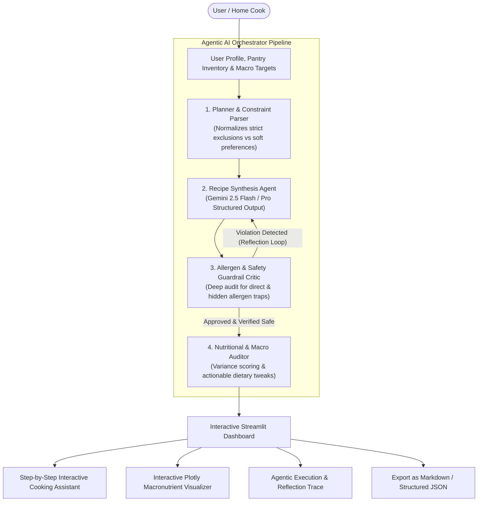

# NutriAgent AI: Personalized Recipe Generation Using a Generative Language Model

**Domain:** Generative AI & Agentic AI Systems  
**Project Title:** Design and Development of a Working Prototype for Personalized Recipe Generation Using a Generative Language Model  

---

## 📌 Executive Summary & Motivation
Traditional recipe recommendation systems rely on static database lookups or collaborative filtering, failing to account for dynamic pantry ingredients, multi-variable nutritional constraints, and strict medical dietary requirements (e.g., celiac disease, severe nut allergies). Conversely, unconstrained Generative AI models often hallucinate culinary steps, suggest unsafe cross-contaminating substitutions, or miscalculate macronutrient distributions.

**NutriAgent AI** solves this through an **Agentic Multi-Agent Reflection Architecture**. By decoupling recipe synthesis from safety verification and macronutrient auditing, the system achieves:
1. **Dynamic Zero-Waste Pantry Utilization**: Adapts to available ingredients while highlighting missing items and culinary substitutions.
2. **Deterministic & LLM Allergen Guardrails**: Strict multi-pass audit filtering direct allergen violations and hidden traps (e.g., wheat in soy sauce, anchovies in Worcestershire, dairy in butter/ghee).
3. **Self-Correction Reflection Loop**: Automatically rejects unsafe candidate recipes and feeds explicit corrective instructions back to the Generative Language Model.
4. **Precision Macro & Calorie Balancing**: Calibrates energy, protein, carbohydrates, fats, and fiber with interactive health scoring.

---

## 🏗️ System Architecture & Workflow



---

## 🧩 Multi-Agent Decomposition

| Agent | Core Responsibility | Verification Mechanism |
| :--- | :--- | :--- |
| **Planner Agent** | Ingests user dietary requirements, allergen exclusions, available kitchen appliances, time ceiling, and pantry inventory. | Validates boundary conditions and prepares strict system prompts. |
| **Recipe Synthesis Agent** | Employs Google Gemini with strict `Pydantic` schema enforcement (`Recipe`) to generate delicious, scaled culinary recipes. | Structured JSON output guarantees parseable, type-safe recipe models. |
| **Allergen Critic Agent** | Inspects every ingredient and preparation step for direct and hidden allergen violations. | Deterministic culinary trap dictionary + LLM reflection critique. Rejection triggers an automated re-prompt. |
| **Nutrition Auditor Agent** | Computes actual vs. target calorie/macro variances, assigns an objective health score (1–10), and produces actionable tweaks. | Mathematical variance auditing across protein, carbs, fats, and dietary fiber. |

---

## 🚀 Getting Started

### Prerequisites
- Python 3.10+ (Tested on Python 3.13)
- Google Gemini API Key (Optional: system includes a built-in intelligent offline mock engine for evaluation without an API key).

### Installation
1. Clone or navigate to the project directory:
   ```bash
   cd C:\Users\harsh\.gemini\antigravity\scratch\personalized_recipe_ai
   ```

2. Install dependencies:
   ```bash
   pip install -r requirements.txt
   ```

3. (Optional) Set up your Gemini API Key:
   - Copy `.env.example` to `.env`:
     ```bash
     copy .env.example .env
     ```
   - Add your key: `GEMINI_API_KEY=your_key_here`
   - Alternatively, you can input your key directly into the application's sidebar.

### Running the Prototype
Launch the Streamlit web application:
```bash
streamlit run app.py
```
Or double-click `run_app.bat` on Windows.

---

## 🧪 Automated Verification & Test Suite
The project includes a suite of automated unit tests covering all agents and guardrails:
```bash
python test_prototype.py
```

### Verified Test Cases:
- `test_planner_agent`: Validates constraint parsing and agent trace logging.
- `test_allergen_critic_safe_recipe`: Confirms false-positive-free passage for safe meals.
- `test_allergen_critic_catches_hidden_allergen`: Confirms detection of subtle hidden traps (e.g. soy sauce wheat trap, butter dairy trap).
- `test_nutrition_auditor`: Verifies calorie variance and health score computation.
- `test_orchestrator_pipeline`: Validates end-to-end execution of the multi-agent reflection pipeline.

---

## 📊 File Structure
```
personalized_recipe_ai/
│
├── app.py                # Interactive Streamlit Web Application & UI Dashboard
├── agents.py             # Multi-Agent Architecture (Planner, Generator, Critic, Auditor, Orchestrator)
├── models.py             # Pydantic Schemas (UserProfile, PantryInventory, Recipe, AuditResults)
├── sample_data.py        # Presets, Common Pantry Items, and Allergen Hidden Trap Knowledge Base
├── test_prototype.py     # Comprehensive automated test suite
├── requirements.txt      # Project dependencies
├── .env.example          # Sample environment configuration
├── run_app.bat           # 1-click Windows launcher script
└── README.md             # Project documentation & architectural specification
```
